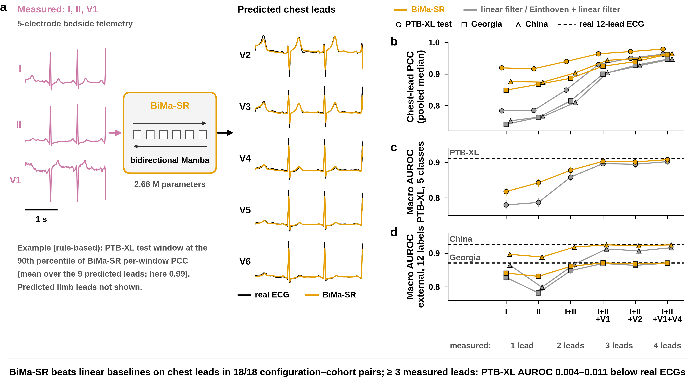

# BiMa-ECGSR: 12-lead ECG reconstruction from reduced lead sets

Bidirectional-Mamba models that reconstruct all twelve ECG leads (I, II, III, aVR, aVL, aVF, V1-V6) from one to four
measured leads, trained on PTB-XL and validated externally on two cohorts never used for training (Georgia 12-lead,
USA; Chapman-Shaoxing/Ningbo, China).

- **BiMa-SR** — regression model: convolutional encoder, bidirectional Mamba stack (Mamba v1, 4 blocks x 8 layers,
  d_model 64, d_state 16), convolutional decoder with an encoder-decoder skip and a lead residual; one forward pass
  (about 2.68 M parameters).
- **DiBiMa-SR** — the same backbone trained as a DDPM (T = 20, cosine schedule rescaled to zero terminal SNR,
  x0-prediction); sampling starts from pure Gaussian noise, one-step (t = 19) or DDIM-6 (about 2.69 M parameters).
- **Judge** — one 12-lead 1D-ResNet trained on real PTB-XL ECGs only, applied unchanged to real and to reconstructed
  ECGs to measure diagnostic readability (5 PTB-XL superclasses; 12-label rhythm/morphology panel shared with Georgia
  and China).

## Input-lead configurations

| configuration | run (BiMa-SR) | DiBiMa-SR | baselines | note |
|---|---|---|---|---|
| II | `bima_sr_II` | `dibima_sr_II` | FIR | single-lead monitoring |
| I | `bima_sr_I` | — | FIR | limb lead I (e.g. wearable) |
| I+II | `bima_sr_I_II` | — | FIR, Einthoven/Goldberger + FIR | limb leads exactly derivable |
| I+II+V1 | `bima_sr_I_II_V1` | — | FIR, Einthoven/Goldberger + FIR | 5-electrode bedside telemetry |
| I+II+V2 | `bima_sr_I_II_V2` | — | FIR, Einthoven/Goldberger + FIR | |
| I+II+V1+V4 | `bima_sr_I_II_V1_V4` | — | FIR, Einthoven/Goldberger + FIR | |

FIR = multi-input linear finite-impulse-response filter (101 taps per input lead, least squares on 4,000 PTB-XL
training windows). Run names are the sub-directories of `$BIMA_RUNS_DIR`; the configuration list lives in
`bima_ecgsr/config.py` (`CONFIGS`).

## Results

<!-- RESULTS:BEGIN -->
<!-- generated by tools/readme_tables.py from results/final/*.csv; do not edit by hand -->

### Reconstruction fidelity, all six input configurations

Pooled median Pearson correlation (PCC) over all predicted leads, 95% record-bootstrap CI (B = 1,000), BiMa-SR vs the strongest linear baseline of each configuration (`results/final/table1_reconstruction.csv`):

| input leads | baseline | PTB-XL test BiMa-SR | PTB-XL test baseline | Georgia BiMa-SR | Georgia baseline | China BiMa-SR | China baseline |
|---|---|---|---|---|---|---|---|
| II | linear FIR | 0.914 (0.911-0.916) | 0.784 (0.777-0.790) | 0.871 (0.869-0.873) | 0.772 (0.768-0.775) | 0.880 (0.879-0.881) | 0.789 (0.787-0.790) |
| I | linear FIR | 0.906 (0.903-0.909) | 0.789 (0.783-0.795) | 0.835 (0.832-0.837) | 0.754 (0.750-0.757) | 0.857 (0.856-0.858) | 0.750 (0.748-0.751) |
| I+II | Einthoven/Goldberger + FIR | 0.980 (0.980-0.981) | 0.959 (0.958-0.961) | 0.967 (0.967-0.968) | 0.950 (0.949-0.951) | 0.970 (0.969-0.970) | 0.948 (0.947-0.948) |
| I+II+V1 | Einthoven/Goldberger + FIR | 0.989 (0.989-0.989) | 0.979 (0.979-0.980) | 0.983 (0.983-0.983) | 0.978 (0.977-0.978) | 0.983 (0.983-0.984) | 0.973 (0.972-0.973) |
| I+II+V2 | Einthoven/Goldberger + FIR | 0.991 (0.990-0.991) | 0.985 (0.984-0.985) | 0.987 (0.986-0.987) | 0.984 (0.984-0.985) | 0.986 (0.985-0.986) | 0.979 (0.979-0.979) |
| I+II+V1+V4 | Einthoven/Goldberger + FIR | 0.995 (0.995-0.995) | 0.999 (0.998-0.999) | 0.994 (0.994-0.994) | 0.999 (0.999-0.999) | 0.993 (0.993-0.993) | 0.999 (0.999-0.999) |

Precordial predicted leads only (V1-V6 minus measured inputs):

| input leads | baseline | PTB-XL test BiMa-SR | PTB-XL test baseline | Georgia BiMa-SR | Georgia baseline | China BiMa-SR | China baseline |
|---|---|---|---|---|---|---|---|
| II | linear FIR | 0.917 (0.914-0.919) | 0.785 (0.778-0.791) | 0.867 (0.865-0.869) | 0.763 (0.759-0.766) | 0.874 (0.873-0.875) | 0.765 (0.764-0.767) |
| I | linear FIR | 0.919 (0.916-0.922) | 0.783 (0.776-0.790) | 0.849 (0.846-0.851) | 0.741 (0.737-0.745) | 0.876 (0.875-0.877) | 0.752 (0.750-0.753) |
| I+II | Einthoven/Goldberger + FIR | 0.939 (0.938-0.941) | 0.849 (0.845-0.854) | 0.886 (0.884-0.888) | 0.815 (0.812-0.818) | 0.903 (0.902-0.904) | 0.810 (0.808-0.811) |
| I+II+V1 | Einthoven/Goldberger + FIR | 0.964 (0.962-0.965) | 0.930 (0.927-0.932) | 0.924 (0.923-0.926) | 0.900 (0.898-0.901) | 0.943 (0.943-0.944) | 0.904 (0.903-0.905) |
| I+II+V2 | Einthoven/Goldberger + FIR | 0.971 (0.970-0.972) | 0.950 (0.949-0.952) | 0.939 (0.938-0.940) | 0.927 (0.926-0.928) | 0.949 (0.949-0.950) | 0.926 (0.926-0.927) |
| I+II+V1+V4 | Einthoven/Goldberger + FIR | 0.979 (0.978-0.979) | 0.962 (0.961-0.964) | 0.962 (0.961-0.963) | 0.947 (0.946-0.947) | 0.965 (0.965-0.965) | 0.947 (0.947-0.948) |

### Lead-II input: regression vs diffusion (`results/final/sr_overall.csv`)

| cohort (windows) | BiMa-SR | DiBiMa-SR one-step | DiBiMa-SR DDIM-6 | linear FIR |
|---|---|---|---|---|
| PTB-XL test (4,396) | 0.914 (0.911-0.916) | 0.903 (0.900-0.907) | 0.862 (0.859-0.865) | 0.784 (0.777-0.790) |
| Georgia (20,547) | 0.871 (0.869-0.873) | 0.862 (0.860-0.864) | 0.819 (0.817-0.821) | 0.772 (0.768-0.775) |
| China (87,105) | 0.880 (0.879-0.881) | 0.866 (0.865-0.867) | 0.827 (0.827-0.828) | 0.789 (0.787-0.790) |

### Diagnostic readability (`results/final/table2_classifier.csv`)

Record-level macro AUROC of the 12-lead judge (trained on real PTB-XL ECGs only) on real and reconstructed ECGs:

*PTB-XL test, 5 diagnostic superclasses*

| input leads | real 12-lead | BiMa-SR | DiBiMa-SR one-step | Einthoven/Goldberger + FIR | linear FIR |
|---|---|---|---|---|---|
| II | 0.912 | 0.843 | 0.835 | — | 0.787 |
| I | 0.912 | 0.818 | — | — | 0.780 |
| I+II | 0.912 | 0.878 | — | 0.859 | 0.856 |
| I+II+V1 | 0.912 | 0.903 | — | 0.897 | 0.894 |
| I+II+V2 | 0.912 | 0.901 | — | 0.895 | 0.891 |
| I+II+V1+V4 | 0.912 | 0.908 | — | 0.902 | 0.899 |

*PTB-XL test, 12-label panel*

| input leads | real 12-lead | BiMa-SR | DiBiMa-SR one-step | Einthoven/Goldberger + FIR | linear FIR |
|---|---|---|---|---|---|
| II | 0.945 | 0.921 | 0.901 | — | 0.835 |
| I | 0.945 | 0.920 | — | — | 0.906 |
| I+II | 0.945 | 0.941 | — | 0.899 | 0.898 |
| I+II+V1 | 0.945 | 0.940 | — | 0.936 | 0.935 |
| I+II+V2 | 0.945 | 0.942 | — | 0.937 | 0.937 |
| I+II+V1+V4 | 0.945 | 0.941 | — | 0.939 | 0.938 |

*Georgia, 12-label panel*

| input leads | real 12-lead | BiMa-SR | DiBiMa-SR one-step | Einthoven/Goldberger + FIR | linear FIR |
|---|---|---|---|---|---|
| II | 0.871 | 0.831 | 0.828 | — | 0.782 |
| I | 0.871 | 0.841 | — | — | 0.828 |
| I+II | 0.871 | 0.861 | — | 0.848 | 0.848 |
| I+II+V1 | 0.871 | 0.871 | — | 0.869 | 0.869 |
| I+II+V2 | 0.871 | 0.868 | — | 0.864 | 0.863 |
| I+II+V1+V4 | 0.871 | 0.871 | — | 0.870 | 0.870 |

*China, 12-label panel*

| input leads | real 12-lead | BiMa-SR | DiBiMa-SR one-step | Einthoven/Goldberger + FIR | linear FIR |
|---|---|---|---|---|---|
| II | 0.926 | 0.888 | 0.873 | — | 0.799 |
| I | 0.926 | 0.897 | — | — | 0.865 |
| I+II | 0.926 | 0.918 | — | 0.867 | 0.867 |
| I+II+V1 | 0.926 | 0.924 | — | 0.912 | 0.912 |
| I+II+V2 | 0.926 | 0.922 | — | 0.907 | 0.907 |
| I+II+V1+V4 | 0.926 | 0.924 | — | 0.916 | 0.916 |
<!-- RESULTS:END -->



## Repository layout

```
bima_ecgsr/                 Python package
  config.py                 paths (env-var overridable) and study configurations
  data/                     pipeline.py (preprocessing), build_dataset.py (dataset build), constants.py (label definitions)
  models/                   backbone.py (BiMaSRNet, BidirectionalMamba), mamba_backend.py (mamba_ssm | torch),
                            mamba_torch.py + scan_numba.py (pure-PyTorch / numba Mamba for CPU inference)
  training/train_sr.py      training, test-set inference, FIR/Einthoven baselines (CLI)
  classification/           judge: classifier, training, prediction, AUROC metrics, real-ECG evaluation
  evaluation/               sr_stats.py (fidelity + bootstrap CIs), cls_recon.py (judge on reconstructions, paired deltas)
  plotting/style.py         figure style (colours, fonts, mm-based layout helpers)
scripts/                    queue_sr.sh (training queue), queue_sr_extra.sh (I+II+V1 follow-up), smoke_sr.sh,
                            run_classifier.sh, run_all.sh (statistics + figures)
figures/                    figure scripts, rendered figures (PNG/PDF/SVG) and captions/
results/                    result tables (CSV)
source_data/                source data of every figure panel (CSV)
docs/                       PIPELINE.md (preprocessing methods), CLASSIFIER.md, verification/ (equivalence, Space checks)
tests/                      unit tests (pipeline, reconstruction, classifier, CPU Mamba backend)
tools/verify_equivalence.py numerical equivalence of this code with the stored study outputs
space/                      Hugging Face Space (Gradio app, engine, weight staging, deploy script)
```

## Installation

```bash
conda create -n bima-ecgsr python=3.13 && conda activate bima-ecgsr
pip install -r requirements.txt          # torch + mamba_ssm (CUDA) for training; numba for CPU inference
```
Run everything from the repository root (`python -m bima_ecgsr...`); scripts pick the interpreter from `BIMA_PYTHON`.

### Paths (environment variables)

| variable | meaning | default |
|---|---|---|
| `BIMA_DATA_DIR` | preprocessed memmaps (`X_*.npy`, `STATS_*.npy`, `meta_*.csv`) | `/media/gtimpano/Data/UGO/dibima_sr12_v2_data` |
| `BIMA_RUNS_DIR` | reconstruction runs | `/media/gtimpano/Data/UGO/dibima_sr12_v2_runs` |
| `BIMA_CLS_DIR` | classifier runs | `/media/gtimpano/Data/UGO/dibima_cls_v2_runs` |
| `BIMA_RAW_DIR` | raw cohorts (PTB-XL, Georgia, China, PhysioNet/CinC dx maps) | `/home/gtimpano/Scrivania/UGO/LoopedMambaECG/data` |
| `BIMA_PTBXL_DIR`, `BIMA_GEORGIA_DIR`, `BIMA_CHINA_DIR`, `BIMA_DX_REFERENCE_DIR` | per-cohort overrides | under `BIMA_RAW_DIR` |
| `BIMA_RESULTS_DIR`, `BIMA_FIGURES_DIR`, `BIMA_SOURCE_DATA_DIR`, `BIMA_LOG_DIR` | outputs | `results/`, `figures/`, `source_data/`, `scripts/logs/` |
| `BIMA_MAMBA_BACKEND` | `auto` / `mamba_ssm` / `torch` | `auto` (CUDA kernels if available) |

## Reproducing the study

```bash
python -m bima_ecgsr.data.build_dataset --out "$BIMA_DATA_DIR" --workers 24     # dataset (docs/PIPELINE.md)
nohup bash scripts/queue_sr.sh > /dev/null 2>&1 &                                # all reconstruction models + baselines
bash scripts/run_classifier.sh                                                   # the 12-lead judge
bash scripts/run_all.sh                                                          # statistics, judge on reconstructions, figures
```
Single runs, e.g. `python -m bima_ecgsr.training.train_sr --mode regression --input-leads I,II,V1 --name bima_sr_I_II_V1 --amp --accum 4 --eval-bs 128`.
Recipe: 20 epochs, AdamW (lr 1e-3, cosine to 1e-5, weight decay 1e-6), effective batch 32 (4 x 8), bf16, gradient
clipping 1; the checkpoint with the best pooled median PCC on 1,024 fixed validation windows is kept. One training seed
per model.

## Tests

```bash
python tests/test_pipeline.py -v     # 23 tests (raw records + built dataset)
python tests/test_sr.py              # 20 groups (GPU; residual wiring, lead-II path, normalisation, Einthoven, parsing)
python tests/test_classifier.py -v   # 9 tests
python tests/test_mamba_torch.py -v  # 3 tests (CPU Mamba == mamba_ssm; GPU part needs > 4 GB free)
python tools/verify_equivalence.py [--warmup]   # stored-output equivalence (docs/verification/)
python space/tools/smoke_devices.py --tag gpu_auto   # Space inference paths vs stored predictions (see space/tools)
python tools/readme_tables.py                    # regenerate the README results tables from results/final/
```

## Hugging Face Space and weights

`space/` contains a Gradio app that reconstructs the 12 leads for bundled PTB-XL test-fold examples or uploaded
recordings, with a linear FIR baseline and the judge's superclass probabilities. It runs on ZeroGPU (Mamba with the
`mamba_ssm` CUDA kernel after a one-window self-test against the pure-PyTorch implementation, else pure PyTorch on
CUDA) and falls back to the CPU (pure-PyTorch Mamba with a numba scan) without a GPU; device, backend and timings are
shown with each result. Demo Space: <https://huggingface.co/spaces/Ugo96/BiMa-ECGSR>.

Weights are **not** stored in this repository. They are staged with `space/tools/stage_weights.py` (checkpoints of
all seven models, FIR coefficients of all six configurations, the judge and the amplitude prior, with
`MANIFEST.json` and `MANIFEST.sha256`) and published in a private Hugging Face model repository that the Space reads
through its `HF_TOKEN` secret; `space/deploy.py` uploads both. See [space/README.md](space/README.md).
Research demonstration — not for clinical use.

## Data

PTB-XL v1.0.3 (Wagner et al., *Sci. Data* 7, 154, 2020), the Georgia 12-lead ECG database (PhysioNet/Computing in
Cardiology Challenge 2021 release) and the Chapman-Shaoxing/Ningbo large-scale 12-lead ECG arrhythmia database
(PhysioNet ecg-arrhythmia v1.0.0), all from PhysioNet (Goldberger et al., *Circulation* 101, e215, 2000). PTB-XL is
licensed CC BY 4.0; see the respective PhysioNet pages for the licences of the other cohorts. The datasets are not
redistributed here (except six PTB-XL example records in `space/examples/`).

## Licence

MIT (c) Ugo Lomoio — see [LICENSE](LICENSE).
